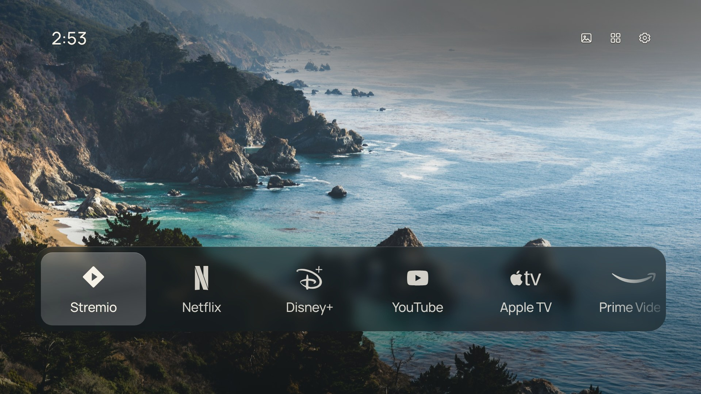

# FoyerLauncher v1.0.1

A calm, uncluttered home screen for smart TVs of many brands, and a way to clear out the bloat they come with: your apps, a photograph and the time, made for the TV remote. An AI agent sets it up with you.



---

## Overview

FoyerLauncher replaces the busy, ad-filled home screen of a smart TV with a quiet one. Home shows up to nine apps you choose over a full-screen photograph, with the clock and, on Android TV, the weather. There are no recommendations, rows of content or ads.

It also clears out what TV makers preinstall. On **Android TV and Google TV sets and boxes**, it hides ad and recommendation services, viewing trackers, store demos and apps you don't use, from researched lists for **Sony, TCL, Hisense, Xiaomi, Philips, Sharp, Panasonic, Toshiba, Nvidia Shield, Chromecast with Google TV, Google TV Streamer, Walmart onn. and Amazon Fire TV**, plus a common list for any other Android TV. You choose what goes. Nothing is uninstalled, and a restore script made for your TV puts everything back.

Setting it up is done by an **AI coding agent** (such as Claude Code) that reads this repository and works through it with you: it asks for your TV's brand, model and IP address, shows you the apps you could hide, installs FoyerLauncher and hands you your restore script.

On **Android TV and Google TV** it installs as an ordinary app. Nothing on the TV is disabled or uninstalled: the TV's own home screen keeps its role, and a small accessibility service sends the remote's Home button to FoyerLauncher instead. Hold Home to reach the TV's own home screen, and turn the service off to put everything back exactly as it was.

On **Samsung Tizen TVs** it runs as a signed Tizen web app, as it did in [CleanFrame](https://github.com/nthnclrk/CleanFrame), the project it grew from.

---

## Functionalities

- **Two layouts:** a glass Dock along the bottom of the photograph, or a text List on a dark or light background.
- **Up to nine Home apps**, arranged with the remote. All apps lists everything installed; apps without a bundled logo use their own icon.
- **Starts with the apps you have:** on Android TV, Home begins with whichever of Live TV, YouTube, Netflix, Prime Video, Disney+, Kodi and VLC are installed. Live TV opens whichever app shows the TV's channels.
- **Fifteen bundled photographs**, with glass materials rendered ahead of time so the TV never blurs anything live.
- **Google ambient photos (Android TV, optional):** Settings → Background → Photos → Google ambient streams a random photo from the set Google's ambient mode shows. Only three are kept: the photo on screen, the one before it and the next.
- **Rotation:** keep one photo, change it each time Home opens, or every minute, 5 minutes, 15 minutes or hour.
- **Clock in 12-hour time with AM/PM.**
- **Weather under the clock (Android TV):** current conditions and temperature in °C or °F, located from the TV's internet address or, when that lookup is blocked, its time zone. Can be turned off.
- **Inputs (Android TV):** switch HDMI and other inputs from Home.
- **Typography:** Manrope, Geist, Roboto or Newsreader, with Small, Medium or Large app names.
- **Focus styles and materials:** glass or type focus; soft, frost or clear-tint glass.
- **Light and dark over photos:** Settings → Focus → Photo appearance. Auto lets text and glass adapt to each photo; Light lays a pale veil with dark text and white glass; Dark deepens the photo with white text and smoky glass. Plain Light and Dark backgrounds are in Background.
- **Back and Hold Home** always lead to the TV's own home screen and settings.
- **About:** Settings → About shows the version, What's New and the privacy policy, and links to support the project, the developer's website and the source code, each as a QR code to scan with your phone.
- **Private by design:** no accounts, analytics, ads or tracking. Settings stay on the TV. See [PRIVACY.md](PRIVACY.md).
- **Debloat (Android TV, Google TV, Fire TV):** hides preinstalled bloat you choose from a list for your TV's brand. Each app is marked recommended, optional, keep or never from public research with sources; apps that keep the TV working (tuner, inputs, remote, picture and sound, the TV's own home and setup) can't be hidden. See [debloat/](debloat/README.md).
- **A restore script for your TV:** every change is recorded on your computer, in `my-tvs/<model>-<serial>/restore-my-tv.sh`, which puts back each hidden app exactly as it was, gives the Home button back, and can remove FoyerLauncher. It needs only adb.

---

## Tech Stack

| Layer | Technology |
|---|---|
| Interface | HTML, CSS and ES5 JavaScript, shared by both platforms (`app/`) |
| Android TV shell | Java 8 source, Android WebView, accessibility service (`android/`) |
| Android build | Android SDK command-line tools (aapt2, javac, d8, zipalign, apksigner); no Gradle |
| Tizen packaging | Tizen web app (`app/config.xml`), Tizen SDK command-line tools |
| Platform adapters | `app/device-android.js` (Android bridge) and `app/device.js` (Tizen application API) |
| Weather | [Open-Meteo](https://open-meteo.com) forecast and geocoding, [ipwho.is](https://ipwho.is) location |
| Asset tooling | Node.js and Playwright (Chromium) for material rendering and icon metrics; Python for packaging and checks |
| Debloat | Bash and adb, with per-brand lists built from research (`debloat/`) |
| Tests | Playwright browser checks against the real UI, with a mock Android bridge; the debloat, install and restore scripts against fake TVs |

---

## Requirements

- **An AI coding agent** that can run commands on your computer, such as Claude Code, to do the installation with you.
- **On the TV: Developer options and debugging turned on.** Installing, debloating and restoring all work over ADB (Android Debug Bridge), so the TV must have **Developer options** unlocked and **USB debugging** (also called ADB or Network debugging) or **Wireless debugging** turned on. Your agent walks you through it during setup. The TV and the computer must be on the same network.
- **Android TV / Google TV:** Android TV OS 8.0 (API 26) or later, any brand. Developed on Google TV running Android TV OS 12.
- **Amazon Fire TV:** debloat only; Fire OS doesn't let another app take the Home button.
- **Samsung:** a Tizen TV with developer mode. Developed on Tizen 9.0; the package declares 6.5.
- **To build:** Node.js 22+, Python 3.10+, `npm ci`, and Chromium for the checks (`npx playwright install chromium`).
- **Android builds:** Android SDK platform 34 and build-tools 35.0.0, a JDK 17+, and `adb`. Android Studio's bundled SDK and JDK are found automatically on macOS; elsewhere set `ANDROID_HOME` and `JAVA_HOME`.
- **Tizen builds:** the Tizen SDK command-line tools and your own Samsung certificates. See [docs/agent-tv-setup-guide.md](docs/agent-tv-setup-guide.md).

---

## What's New in 1.0.1

- **Security fixes from a full review.** The setup scripts now treat everything a TV reports as plain text, so a tampered TV, or a device posing as yours on the network, can't slip a command into your TV's restore script.
- **The home screen runs only its own code** (a content-security policy), and Google ambient photos that are oversized or oddly shaped are skipped so they can't use up the TV's memory.
- **[SECURITY.md](SECURITY.md)** gives a private way to report a security problem.
- Nothing changed in how FoyerLauncher looks or works, or in how setup and restore are done.

## What's New in 1.0.0

- **First FoyerLauncher release.** CleanFrame's home screen, renamed and brought to Android TV and Google TV of any brand.
- **Android TV app** that takes over the Home button without disabling anything, and finds the TV's own home screen and Live TV app by itself.
- **Weather, Inputs and Google ambient photos** on Android TV.
- **12-hour clock with AM/PM, Every minute rotation, Small/Medium/Large app names and the Roboto font** on both platforms.
- **Debloat for 12 brands of Android TV**, from researched lists, choosing app by app.
- **Set up by an AI agent** that asks for your TV's details and leaves you **a restore script made for your TV**.

---

## Installation

Installing on a TV **needs an AI coding agent** that can run commands on your computer, such as [Claude Code](https://claude.com/claude-code). The agent reads this repository and follows [docs/agent-android-setup-guide.md](docs/agent-android-setup-guide.md) (Android TV, Google TV and Fire TV of any brand) or [docs/agent-tv-setup-guide.md](docs/agent-tv-setup-guide.md) (Samsung) with you:

1. It asks for your TV's **brand, model, platform, software version and IP address**, and shows you where to find each one. You can type them or send a photo of the settings screen.
2. It walks you through **turning on Developer options and debugging on the TV**: in Settings → System → About, select *Android TV OS build* seven times to unlock Developer options, then turn on *USB debugging* (or *Wireless debugging*) there. Menu names vary by brand; on Fire TV it's Settings → My Fire TV → Developer options → *ADB debugging*. When it connects, the TV asks *Allow USB debugging?*: choose *Always allow from this computer*. The agent then checks it's the TV you described.
3. It shows you **the apps you could hide**, grouped, with what each one does, recommends which to hide and tells you what you'd lose with the rest. You choose, see exactly what will happen, and approve it.
4. It hides your choices, then makes **logos in FoyerLauncher's style for the apps on your TV** that don't have one, from each app's own icon, and shows you a preview to approve.
5. It installs FoyerLauncher and checks with you that the remote, inputs, picture, Wi-Fi and the Home button all work.
6. It hands you **your TV's restore script**, `my-tvs/<model>-<serial>/restore-my-tv.sh`, and shows you what it would undo.

Your TV's details stay on your computer, in the `my-tvs/` folder, which is never part of the project's files. The agent asks before each step that changes the TV.

Debugging lets computers you've approved control the TV over your network. You can turn it off again in Developer options once setup is done; turn it back on before running your restore script or updating FoyerLauncher.

### 1. Get the code

```bash
git clone https://github.com/nycoagung/foyerLauncher.git
cd foyerLauncher
```

### 2. Start your agent there with this prompt

```text
Read AGENTS.md and docs/agent-android-setup-guide.md, then set up my TV
with FoyerLauncher. Ask me for my TV's brand, model, platform, software
version and IP address, and show me where to find each one. If it's a
Samsung TV, follow docs/agent-tv-setup-guide.md instead.
Show me which preinstalled apps can be hidden and let me choose before
you hide anything. Explain each step and ask me before you connect to,
install on or change anything on the TV. Keep my TV's details out of the
project files, and finish by showing me my TV's restore script.
```

### 3. To undo it later

Run your TV's restore script (with debugging turned on, and `TV_IP=<TV_IP>` in front if the TV's address has changed):

```bash
my-tvs/<model>-<serial>/restore-my-tv.sh               # bring back every hidden app and give Home back
my-tvs/<model>-<serial>/restore-my-tv.sh --uninstall   # also remove FoyerLauncher
```

Or ask your agent to do it for you.

### 4. Try the home screen in a browser

```bash
npm ci
npm run dev:public
```

Open http://localhost:4795/home/ (Samsung adapter) or http://localhost:4795/home/?device=android (Android adapter). Arrow keys, Enter and Escape act as the remote. The preview can't open apps.

### 5. Run tests

```bash
npm run check                               # syntax, widget identity and bundled resources
FOYER_PUBLIC_FONTS=1 npm run check:browser  # interface checks in Chromium
npm run check:android                       # Android adapter checks with a mock bridge
npm run check:debloat                       # debloat, install and restore scripts against fake TVs
npm run check:public                        # nothing private is about to be published
```

`npm run check` also fails if Settings → About is out of date. After editing `WHATSNEW.md`, `PRIVACY.md` or the version, run `npm run build:about`. If an About link changes, regenerate its QR code with `npm run build:about -- --codes` (needs `pip install segno`).

None of the checks contact a TV.

### Logos for your own apps

Setup makes white marks in FoyerLauncher's style for the apps on your TV that have no bundled logo (`node scripts/marks-from-tv.mjs --auto`), from each app's own icon, and you approve them from a preview. Apps whose icon can't become a clean shape keep their own icon. The marks are your TV's only: they go into the ignored `app/assets/icons/local/`, only your own Android build includes them, and they are never published.

---

## Author

**Nyco Agung** — [nycoagung@hotmail.com](mailto:nycoagung@hotmail.com)

FoyerLauncher is built on [CleanFrame](https://github.com/nthnclrk/CleanFrame) by Nathan Clark.

---

## License

This project is licensed under the **GNU General Public License v2.0** (or any later version).
See the [LICENSE](LICENSE) file for the full text.

Parts that came from CleanFrame remain available under its MIT licence, and fonts, photographs and brand marks keep their own terms: see [THIRD_PARTY_NOTICES.md](THIRD_PARTY_NOTICES.md). FoyerLauncher is an independent project, not affiliated with or endorsed by Google, Samsung or any streaming service.

---

## Changelog

See [CHANGELOG.md](CHANGELOG.md) for a detailed history of changes, and [WHATSNEW.md](WHATSNEW.md) for a short summary of each release.
